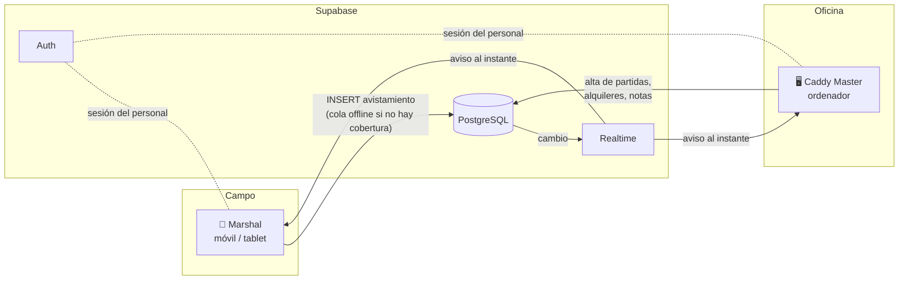
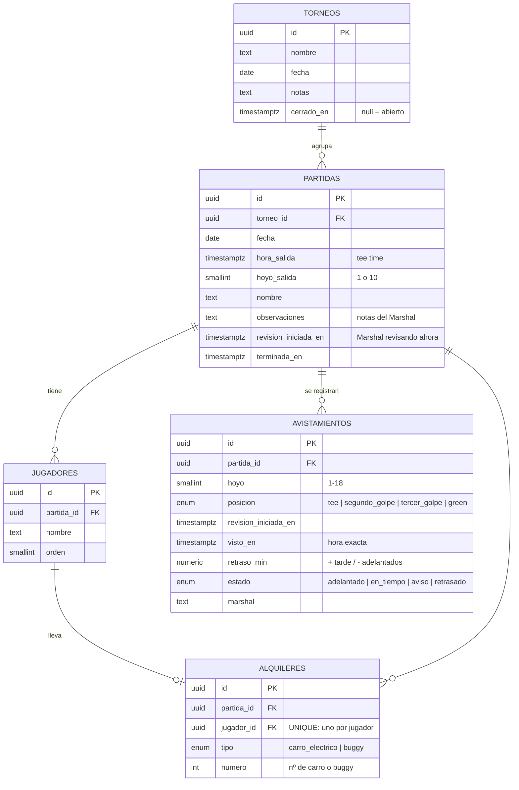
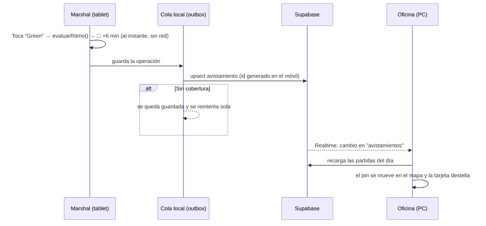

# Arquitectura · Ritmo de juego

Este documento responde a los cuatro entregables: stack, base de datos, lógica del ritmo y estructura del código en tiempo real.



## 1. Stack tecnológico

| Capa | Tecnología | Por qué |
| --- | --- | --- |
| **Frontend** | React 19 + TypeScript + Vite 7 | Una sola WebApp responsiva para móvil, tablet y PC. TypeScript evita errores con los datos. Vite arranca al instante. |
| Estilos | Tailwind CSS 4 | Diseño responsivo rápido. Tema claro de alto contraste para usarlo a pleno sol. |
| Rutas | React Router 7 | `/marshal`, `/marshal/:id`, `/oficina`, `/calibrar`. |
| Instalable | Web App Manifest (PWA) | Se puede "Añadir a pantalla de inicio" en la tablet y abre a pantalla completa. |
| **Backend** | **Supabase** (no hace falta servidor propio) | Da hecho todo lo de servidor: API REST automática sobre las tablas, inicio de sesión, permisos (RLS) y tiempo real. La lógica del ritmo vive en un módulo TypeScript puro (`src/lib/ritmo.ts`). |
| **BD en tiempo real** | PostgreSQL + Supabase Realtime | Cada INSERT/UPDATE/DELETE se envía al momento a todos los dispositivos conectados. |
| Hosting | Vercel o Netlify (gratis) | Es una web estática: `npm run build` y subir `dist/`. Ya incluye `vercel.json` y `public/_redirects`. |
| Tests | Vitest | Pruebas de la lógica del ritmo y de las operaciones. |

### ¿Por qué Supabase y no Firebase?

| | Supabase (elegido) | Firebase (Firestore) |
| --- | --- | --- |
| Modelo de datos | Relacional: partida → jugadores → alquileres / avistamientos encaja de forma natural | Documentos; las relaciones hay que duplicarlas |
| Informes | SQL: "retraso medio por hoyo del último mes" es una consulta | Hay que calcularlo en el cliente o con funciones |
| Tiempo real | Sí (Realtime) | Sí (nativo) |
| Sin cobertura | Lo resuelve la app con una **cola offline** (ver punto 4) | Viene de serie |
| Precio / bloqueo | Plan gratuito amplio, código abierto, es PostgreSQL estándar | Plan gratuito amplio, propietario de Google |

Toda la app habla con la base de datos a través de una interfaz (`src/datos/repositorio.ts`). Si algún día se quiere Firebase, basta con escribir otra implementación de esa interfaz.

## 2. Estructura de la base de datos

El SQL completo, listo para pegar en Supabase, está en [`supabase/schema.sql`](../supabase/schema.sql).



Decisiones importantes:

- **Todo cuelga de `torneos`.** Cada torneo guarda sus partidas y, a través de ellas, jugadores, alquileres, avistamientos y observaciones. Borrar un torneo borra todo lo suyo (`on delete cascade`); cerrarlo solo lo archiva.
- **`avistamientos` es la tabla de "tiempos".** Cada toque del Marshal crea una fila con la hora exacta. El estado actual de una partida es su último avistamiento (vista `estado_partidas`).
- **`visto_en` lo pone el dispositivo**, no el servidor. Si no hay cobertura y el dato llega 10 minutos tarde, la hora sigue siendo la real.
- **Se guarda `retraso_min` y `estado`** en el momento de registrar. Si mañana cambian los umbrales, el histórico no cambia.
- **Los id (UUID) los genera el dispositivo.** Así un reintento tras perder la conexión no crea duplicados.
- **`alquileres.jugador_id` es UNIQUE**: un jugador lleva como máximo un artículo. Dos jugadores de la misma partida sí pueden compartir el mismo buggy.
- **`partidas.revision_iniciada_en`** permite que la oficina vea "Marshal revisando desde 11:40" en directo.
- **Seguridad (RLS):** solo usuarios con sesión iniciada pueden leer y escribir.

Ejemplo de informe (retraso medio por hoyo en los últimos 30 días, para ver dónde se atasca el campo):

```sql
select a.hoyo,
       round(avg(a.retraso_min), 1) as retraso_medio_min,
       count(*)                     as avistamientos
from avistamientos a
join partidas p on p.id = a.partida_id
where p.fecha >= current_date - 30
group by a.hoyo
order by a.hoyo;
```

## 3. Lógica del cálculo del ritmo

Archivo: [`src/lib/ritmo.ts`](../src/lib/ritmo.ts) (funciones puras, con tests en `ritmo.test.ts`).

**Regla:** cada hoyo tiene 15 minutos. Si salen a las 10:00 por el tee del 1, deben terminar el hoyo 1 a las 10:15, el 2 a las 10:30… y la vuelta a las 14:30.

**Cada posición ocupa un tramo de esos 15 minutos** (su "ventana ideal"):

| Posición | Tramo del hoyo | Hoyo 1 (salida 10:00) | Hoyo 2 |
| --- | --- | --- | --- |
| Tee de salida | 0:00 – 3:45 | 10:00 – 10:03 | 10:15 – 10:18 |
| 2º golpe | 3:45 – 7:30 | 10:03 – 10:07 | 10:18 – 10:22 |
| 3er golpe | 7:30 – 11:15 | 10:07 – 10:11 | 10:22 – 10:26 |
| Green | 11:15 – 15:00 | 10:11 – **10:15** | 10:26 – **10:30** |

**Fórmula:**

```
inicioHoyo   = horaSalida + 15 min × (hoyos jugados antes de este)
ventana      = inicioHoyo + [desde, hasta] × 15 min
retraso      = vistoEn − ventana.hasta    si les ves DESPUÉS de la ventana (van tarde, +)
             = vistoEn − ventana.desde    si les ves ANTES de la ventana (van adelantados, −)
             = 0                          si les ves dentro de la ventana
```

"Hoyos jugados antes" tiene en cuenta el tee por el que salen: saliendo por el 10, el hoyo 1 es el décimo que juegan y su ventana empieza 135 min después de la salida. Lo mismo vale para las salidas a tiro (cada partida por un tee del 1 al 18): saliendo por el 4, el último hoyo que juegan es el 3.

**Clasificación** (límites en `CONFIG_RITMO`: `limiteVerde`, `limiteRojo` y `margenAdelanto`). Se usan los minutos enteros que se ven en pantalla, así "+15 min" es siempre rojo:

| Retraso | Estado | Color |
| --- | --- | --- |
| más de 5 min por delante | Adelantado | 🟢 verde |
| de −5 a +5 min | En tiempo | 🟢 verde |
| de +6 a +14 min | Atención | 🟠 ámbar |
| desde +15 min | Retrasado | 🔴 rojo |

El color de lo ya registrado se recalcula al cargar con los límites actuales, así que si se cambian también se actualizan los avistamientos antiguos.

**Código de la función principal:**

```ts
export function evaluarRitmo(salida, hoyo, posicion, vistoEn, cfg = CONFIG_RITMO) {
  const ventana = ventanaIdeal(salida, hoyo, posicion, cfg);
  const visto = vistoEn.getTime();
  let retrasoMs = 0;
  if (visto > ventana.hasta.getTime()) retrasoMs = visto - ventana.hasta.getTime();
  else if (visto < ventana.desde.getTime()) retrasoMs = visto - ventana.desde.getTime();
  const retrasoMin = Math.round((retrasoMs / 60_000) * 10) / 10 + 0;
  return { retrasoMin, estado: clasificarRetraso(retrasoMin, cfg), ventana };
}
```

Ejemplos (salida 10:00 por el tee del 1):

| Les ves en… | a las… | Ventana ideal | Resultado |
| --- | --- | --- | --- |
| Green del 1 | 10:15 | 10:11 – 10:15 | 0 min → 🟢 En tiempo |
| Green del 1 | 10:19 | 10:11 – 10:15 | +4 min → 🟢 En tiempo |
| Tee del 1 | 10:10 | 10:00 – 10:03:45 | +6,3 min → 🟠 Atención |
| Green del 1 | 10:30 | 10:11 – 10:15 | +15 min → 🔴 Retrasado |
| Tee del 3 | 10:20 | 10:30 – 10:33 | −10 min → 🟢 Adelantado |

Además, `posicionEsperada(salida, ahora)` dice dónde *debería* estar cada partida ahora mismo. La oficina lo muestra ("Deberían ir por el H7") y el mapa dibuja un círculo discontinuo en ese punto al seleccionar una partida.

## 4. Código: dashboard y tiempo real

### Flujo de un avistamiento



### Piezas clave

- **`src/datos/operaciones.ts`**: todo cambio es una *operación* (`crear_torneo`, `registrar_avistamiento`, `asignar_alquiler`…). La función `aplicarOperacion` es pura e idempotente.
- **`src/lib/pdf.ts`** + **`src/lib/lineasPdf.ts`** + **`src/lib/importar.ts`**: pdf.js (versión *legacy*, para navegadores no tan nuevos) saca los trozos de texto con su posición; `lineasPdf` los convierte en líneas y, si la página tiene varias columnas de partidas en paralelo (horarios de salida a tiro con dos listas lado a lado), lee cada columna por separado. El intérprete reconoce horas, tee ("TEE: 4", columna, "Tee 10" o cabecera "SALIDAS POR EL TEE 10"), nombres (también cortados o sin coma), la fecha del torneo (no la de impresión del listado) y el título. Probado con el horario real de la Copa Corporate (28 partidas, 109 jugadores). Siempre se revisa en pantalla antes de guardar.
- **`src/lib/exportar.ts`**: CSV para Excel (separador `;`, coma decimal y BOM para las tildes).
- **`src/datos/supabase.ts`**: lee el torneo en uso con una sola consulta anidada (`partidas` + `jugadores` + `alquileres` + `avistamientos`), escucha los cambios de las 5 tablas por Realtime y envía las operaciones mediante una **cola offline** guardada en el dispositivo. Mientras una operación no se ha enviado, la pantalla ya la muestra aplicada.
- **`src/datos/demo.ts`**: misma interfaz pero sin servidor (localStorage + BroadcastChannel). Sirve para probar la app sin configurar nada.
- **`src/datos/DatosProvider.tsx`**: contexto de React. Une los datos del servidor y la cola local, y recarga cuando llega un aviso de tiempo real (agrupando avisos seguidos).
- **`src/paginas/Oficina.tsx`**: dashboard del Caddy Master. Indicadores arriba (que también filtran), mapa en el centro, lista o ficha de la partida a la derecha y "últimos avistamientos" debajo.
- **`src/paginas/MarshalPartida.tsx`** + **`src/componentes/RegistroAvistamiento.tsx`**: pantalla del Marshal. "Empezar revisión", hoyo y posición: un toque registra la hora y muestra el resultado en grande (con vibración y botón Deshacer).
- **`src/componentes/MapaCampo.tsx`**: imagen del campo con un pin por partida (color según estado, hora de salida, hoyo y hora a la que se les vio). Las coordenadas son porcentajes de la imagen, así encajan en cualquier pantalla.

### Estructura de carpetas

```
src/
├── config/campo.ts          ← imagen del mapa y coordenadas de cada hoyo
├── lib/
│   ├── ritmo.ts             ← LÓGICA DEL RITMO (+ tests)
│   ├── partidas.ts          ← estado actual de una partida, búsqueda, avisos de alquiler
│   ├── importar.ts          ← interpreta el horario de salidas (+ tests)
│   ├── pdf.ts               ← saca el texto del PDF (pdf.js)
│   ├── lineasPdf.ts         ← líneas y columnas de la página (+ tests)
│   ├── exportar.ts          ← CSV para Excel (+ tests)
│   ├── hora.ts, ids.ts, textos.ts
├── datos/
│   ├── tipos.ts             ← tipos = columnas de la BD
│   ├── operaciones.ts       ← cambios posibles (+ tests)
│   ├── repositorio.ts       ← interfaz común
│   ├── supabase.ts          ← Supabase + Realtime + cola offline
│   ├── demo.ts              ← modo demo local
│   ├── DatosProvider.tsx    ← contexto React (tiempo real)
│   └── sesion.ts            ← inicio de sesión
├── componentes/             ← mapa, tarjetas, alquileres, observaciones, historial…
└── paginas/                 ← Inicio, Login, MarshalLista, MarshalPartida, Oficina, Calibrar,
                                Torneos, ImportarTorneo, InformeTorneo
supabase/
├── schema.sql               ← tablas, RLS y Realtime
└── datos-prueba.sql
```

## Próximos pasos sugeridos

1. **Roles**: tabla `perfiles` (marshal / oficina) y políticas RLS distintas (p. ej. solo la oficina borra partidas).
2. **Service worker** (p. ej. `vite-plugin-pwa`) para que la app abra aunque no haya cobertura al arrancarla.
3. **Avisos automáticos**: una Edge Function o un trigger que avise (push o sonido en la oficina) cuando una partida pase a rojo.
4. **Tiempos por hoyo**: los par 3 suelen necesitar menos de 15 min y los par 5 más. Basta con cambiar `minutosPorHoyo` en `CONFIG_RITMO`.
5. **Informes** diarios y mensuales con la vista `estado_partidas` y consultas como la de arriba.
6. **GPS del Marshal** (opcional): proponer el hoyo automáticamente según su ubicación.
